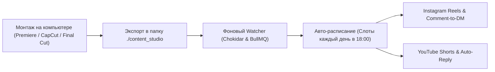

# MultiSocial AutoTool & Local Content Studio

SaaS-платформа для автоматизации кросс-платформенного постинга (Instagram & YouTube) и воронок комментариев (Instagram Comment-to-DM и YouTube Auto-Reply) с **локальным мониторингом папки проектов на вашем компьютере**.

---

## 💡 Как работает локальный рабочий процесс создателя контента

Вам больше не нужно вручную загружать каждое видео в веб-интерфейс:



1. **Вы монтируете контент на компьютере**:
   - Экспортируете видеоролики (`.mp4`, `.mov`) или изображения в папку `./content_studio` (или любую выбранную папку на Mac/ПК, например `/Users/name/Videos/Reels`).
2. **Система сама отслеживает появление файлов**:
   - Chokidar ожидает окончания рендера файла (стабилизация размера файла).
   - Автоматически считывает текст и директивы из парного файла `video.txt` (или генерирует заголовок из названия файла).
3. **Автоматическая постановка в слоты расписания**:
   - Если дата не указана, система автоматически назначает следующий свободный ежедневный слот (например, каждый день в 18:00).
4. **Публикация**:
   - **YouTube Shorts / Video**: байты загружаются напрямую с жесткого диска через официальный Google Resumable Upload API.
   - **Instagram Reels**: медиа стримится через встроенный Range-стриминг API (`/api/media/...`).

---

## 📁 Формат файлов в папке `content_studio/`

Вы можете организовать файлы любым удобным способом:

### Вариант 1: Пара «Видео + Текстовый файл» (Рекомендуемый)
Положите `01_how_to_scale.mp4` и рядом `01_how_to_scale.txt`:
```txt
🔥 Как автоматизировать 100% лидогенерации через комментарии?

В этом видео пошагово показываем настройку автоворонок.
Напишите слово «КУРС» в комментариях, чтобы получить чек-лист в Direct! 👇

#бизнес #reels #shorts #автоматизация
--platform: ALL
--type: REEL
--schedule: 2026-11-10 18:00
```

### Вариант 2: Просто видеофайл
Положите `Kak_sozdat_SaaS.mp4`. Приложение само очистит название от подчеркиваний и создаст черновик или запланирует пост.

---

## ⚡️ Быстрый старт

### 1. Запуск БД и Redis (при наличии Docker)
```bash
docker compose up -d
```
*Либо укажите ваш существующий PostgreSQL в `.env` (например, бесплатную БД на Neon или Supabase).*

### 2. Применение схемы базы данных
```bash
npx prisma db push
```

### 3. Запуск веб-приложения
```bash
npm run dev
```
Откройте [http://localhost:3000](http://localhost:3000)

### 4. Запуск фонового воркера и мониторинга папки
В отдельном терминале запустите:
```bash
npm run worker
```
Воркер автоматически начнет слушать папку `./content_studio`, обрабатывать очереди публикаций и вебхуки триггеров комментариев.

### 5. Для Instagram (публичный доступ к локальному стримингу)
Если вы тестируете Instagram публикацию с локального компьютера:
```bash
npm run tunnel
```
И укажите выданный URL в `.env` в `NEXT_PUBLIC_APP_URL`.

---

## 🎯 Разделы панели управления

- **Студия контента (`/studio`)**: Файловый браузер локальной папки, превью роликов, 1-click импорт всех новых видео в очередь, настройка времени ежедневных слотов постинга.
- **Публикации (`/posts`)**: Календарь и список запланированных постов со статусами.
- **Автоматизация (`/automation`)**: Настройка Comment-to-DM (Instagram) и автоответов (YouTube), а также **интерактивный симулятор триггеров**.
- **Соц. аккаунты (`/accounts`)**: Подключение Instagram (Facebook Login), YouTube (Google OAuth) или 1-клик тестовых демо-аккаунтов.
- **Журнал логов (`/logs`)**: История всех входящих комментариев и отправленных Direct сообщений.
- **Биллинг (`/billing`)**: Тарифные планы Creator ($29), Pro ($79), Agency ($199) через Stripe.
