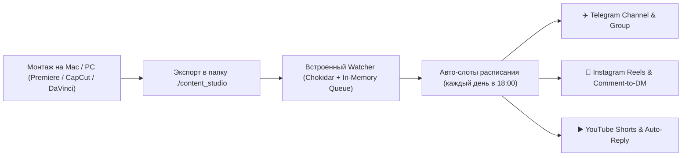

# 🚀 MultiSocial AutoTool & Local Content Studio

> **Open-Source кросс-платформенная платформа для создателей контента, рилсмейкеров и SMM-команд.**  
> Мониторинг локальной папки монтажа на вашем компьютере → Авто-расписание слотов постинга → Автоворонки комментариев (Comment-to-DM & Auto-Reply).

[](https://nextjs.org/)
[](https://www.typescriptlang.org/)
[](https://sqlite.org/)
[]()
[](https://opensource.org/licenses/MIT)

---

## 💡 В чём ключевая идея?

Обычные сервисы автопостинга заставляют вас открывать браузер, вручную перетаскивать каждый ролик, вбивать текст и расписание заново.

**MultiSocial AutoTool связывает ваш компьютер напрямую с соцсетями:**



1. **Экспортируете видеоролики** прямо в папку проекта `./content_studio` (или любую свою папку, например `~/Videos/Reels`).
2. **Система сама обнаруживает новые файлы**, ждет завершения рендера и считывает текст из файла `video.txt`.
3. **Автоматически ставит в следующий свободный слот** (например, каждый день в 18:00).
4. **Публикует** в Telegram, Instagram Reels и YouTube Shorts.
5. **Автоматически отвечает в комментариях и шлет материалы в Direct (DM)** при получении кодового слова (например, «КУРС» или «ЦЕНА»).

---

## ⚡️ Быстрый старт за 60 секунд (Zero-Docker / Zero-Config)

Приложение спроектировано так, чтобы **любой пользователь мог запустить его в 1 команду без установки Docker, Redis и PostgreSQL**:

### 1. Клонирование и установка
```bash
git clone https://github.com/<ваш-логин>/multisocial-autotool.git
cd multisocial-autotool
npm install
```

### 2. Запуск приложения (всё в одном процессе!)
```bash
npm run dev
```

Откройте в браузере: **[http://localhost:3000](http://localhost:3000)**

> [!TIP]
> **Никаких дополнительных терминалов!** Локальная база данных SQLite (`dev.db`), фоновый файловый наблюдатель за папкой и очередь задач запускаются автоматически внутри единого процесса.

---

## 🎮 Мгновенный тест: Демо-режим в 1 клик

1. На главной панели управления нажмите кнопку **«Запустить Демо-режим (1 клик)»**.
2. Система мгновенно создаст тестовые аккаунты и подхватит готовые примеры роликов из `./content_studio`.
3. Перейдите в раздел **«Автоматизация»** → введите фразу в интерактивном симуляторе комментариев и посмотрите, как бот находит триггер и готовит ответ в Direct!

---

## ✈️ Подключение социальных сетей

### 1. Telegram (Рекомендуется для быстрого старта — 30 секунд)
Самый быстрый способ первой реальной публикации **без ожидания модераций Meta и Google Cloud**:
1. Откройте в Telegram бота `@BotFather` и напишите команду `/newbot`.
2. Скопируйте выданный API токен.
3. Добавьте созданного бота администратором в ваш канал или группу.
4. В разделе «Соц. аккаунты» нажмите **«Подключить бота»** и введите токен и юзернейм канала (например `@my_channel`).
5. Готово! Любое видео из вашей папки теперь может публиковаться в канал.

### 2. Instagram Business & Creator
- Публикация постов и Reels через официальный Meta Graph API.
- Comment-to-DM: прием входящих вебхуков комментариев и моментальная отправка ссылок в Direct.
- Для локального тестирования вебхуков используйте встроенную команду туннеля:
  ```bash
  npm run tunnel
  ```

### 3. YouTube Shorts & Video
- Авторизация через Google OAuth 2.0.
- Загрузка видео напрямую с диска через Google Resumable Media Upload.
- Автоматические ответы на комментарии под вашими видео.

---

## 📁 Формат файлов в папке `content_studio/`

### Вариант 1: Видео + текстовый файл с директивами
Положите `01_scale_saas.mp4` и рядом `01_scale_saas.txt`:
```txt
🔥 Как автоматизировать лидогенерацию на 100%?
В этом видео разбираем настройку автоворонок комментариев.
Напишите «КУРС» в комментариях, чтобы получить чек-лист в Direct! 👇

#бизнес #reels #shorts #telegram #маркетинг
--platform: ALL
--type: REEL
--schedule: 2026-11-12 18:00
```

### Вариант 2: Просто видеофайл
Положите `Kak_nastroit_bot.mp4`. Система сама очистит имя от знаков подчеркивания и создаст черновик с заголовком «Kak nastroit bot».

---

## 🛠 Архитектура проекта

- **Фреймворк**: Next.js 15 (App Router, Server Actions, API routes, Instrumentation).
- **База данных**: SQLite (по умолчанию для легкого старта) или PostgreSQL (для облачного продакшена) через Prisma ORM.
- **Очереди и планировщик**: Встроенный Embedded In-Memory Scheduler с автоматическим переключением на BullMQ / Redis при их наличии.
- **Мониторинг файлов**: Chokidar с дебаунсом стабилизации размера файлов при рендеринге.
- **Стилизация**: Tailwind CSS, Lucide Icons.

---

## 🗺 Дорожная карта развития (Roadmap)

- [x] Zero-Config SQLite запуск без Docker
- [x] Единый процесс запуска (Server + Watcher + Queue)
- [x] Поддержка Telegram-каналов и групп
- [x] Интерактивный симулятор триггеров Comment-to-DM
- [ ] Готовый Desktop-билд (.dmg / .exe на Tauri) для создателей контента без терминала
- [ ] Поддержка TikTok Content Posting API
- [ ] Поддержка ВКонтакте (VK Клипы и посты)
- [ ] AI-ассистент: генерация сценариев и хэштегов по видеоряду через Gemini API

---

## 📄 Лицензия

Распространяется под свободной лицензией MIT. Вы можете использовать проект в личных и коммерческих целях.
